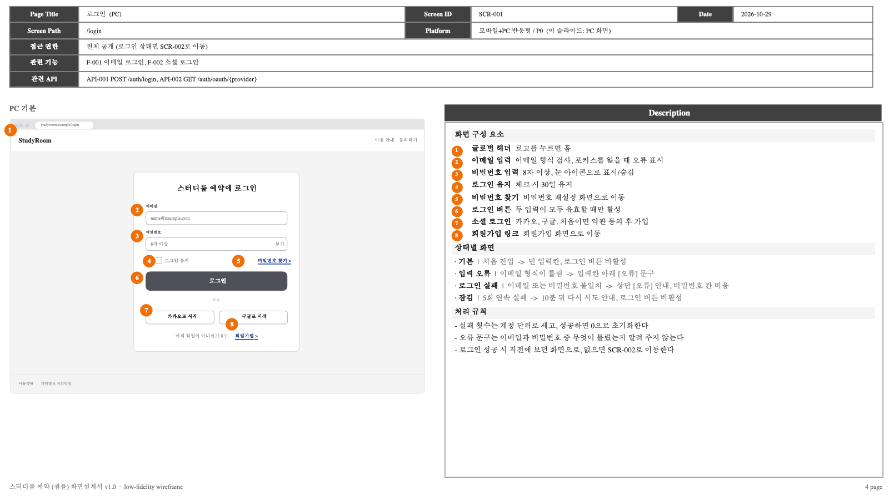
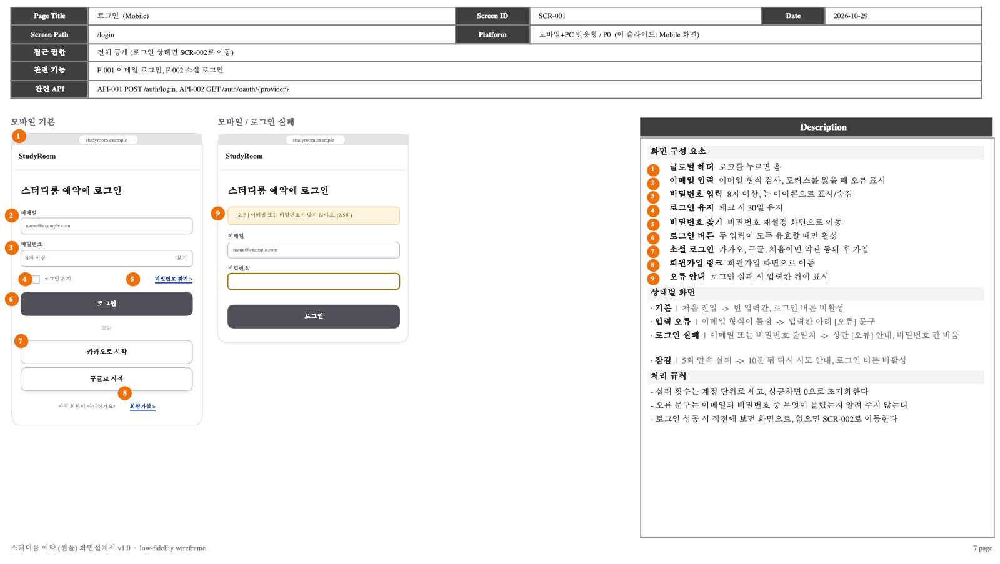
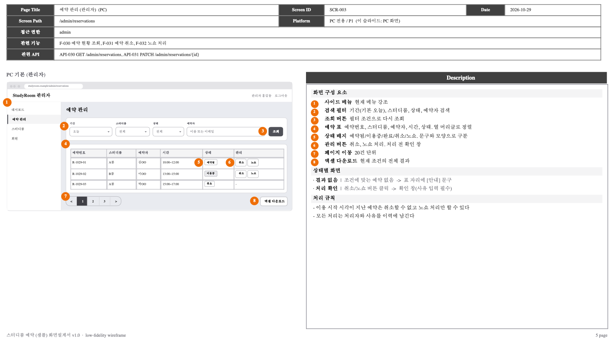
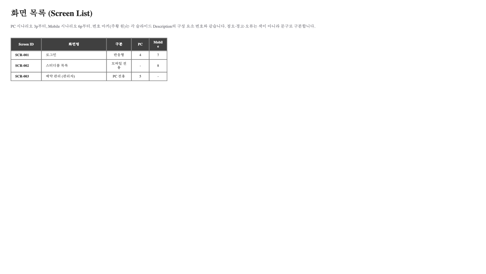

# sb-lowfi

**마크다운 화면설계서를 개발자에게 바로 넘길 수 있는 low-fi 와이어프레임 PPTX와 Figma 화면설계서로 만들어 주는 Claude Code 스킬입니다.**

ASCII 그림으로 그린 화면설계서는 기획자끼리는 읽혀도 개발자나 디자이너에게 넘기기는 어렵습니다. `sb-lowfi`는 화면설계서(.md)를 읽어 박스·입력칸·버튼을 실제 도형으로 그린 low-fi 와이어프레임을 만들고, 현업에서 쓰는 화면설계서 형식(상단 메타 표 + 와이어프레임 + 번호별 Description)으로 출력합니다.

| 스킬 | 입력 | 출력 |
|------|------|------|
| `sb-lowfi-pptx` | 화면설계서.md | low-fi 와이어프레임 HTML, **편집 가능한 PPTX** |
| `sb-lowfi-figma` | `sb-lowfi-pptx`가 만든 HTML + 화면설계서.md + flows.json | **Figma 화면설계서** (PC·Mobile 시나리오 페이지, 화면 흐름도) |



<details>
<summary>슬라이드 더 보기 (Mobile, 관리자, 화면 목록)</summary>





</details>

> 미리보기 이미지는 macOS Quick Look으로 렌더링해서 글꼴이 대체 글꼴로 보입니다. PowerPoint에서 열면 맑은 고딕으로 표시됩니다. 샘플 결과물 원본은 [`examples/output/`](examples/output/)에 있습니다.

## 특징

- **모든 요소가 PowerPoint 네이티브 도형입니다.** 이미지가 아니라서 글자, 박스 색, 위치를 PowerPoint에서 바로 고칠 수 있습니다.
- **현업 화면설계서 레이아웃.** 슬라이드마다 상단 메타 표(Page Title, Screen ID, Date, Screen Path, Platform, 접근 권한, 관련 기능, 관련 API), 왼쪽 와이어프레임, 오른쪽 Description(구성 요소 + 상태별 화면 + 처리 규칙)을 둡니다.
- **PC와 Mobile을 따로 묶습니다.** 표지 → 화면 목록 → PC 시나리오 전체 → Mobile 시나리오 전체 순서입니다.
- **고정 축척.** PC 1000px, Mobile 375px를 항상 같은 크기로 그립니다. 설명이 길다고 와이어프레임이 줄어들지 않고, 한 장을 넘는 긴 화면은 빈 줄에서 자동으로 나눕니다.
- **번호 마커가 글자를 가리지 않습니다.** 마커가 글자나 다른 마커와 겹치면 빈자리로 자동으로 옮기고, 상태 화면(오류, 빈 상태)에는 기본 화면의 같은 요소 번호를 자동으로 붙입니다.
- **Description에는 그 슬라이드에 보이는 번호만 나옵니다.**
- **Figma 출력.** 화면마다 Section을 하나씩 만들고 1:1 크기 와이어프레임, 화면 설명 열, 상태·규칙 열을 둡니다. 페이지 맨 위의 화면 흐름도에서 박스를 누르면 해당 화면으로 이동합니다. 다시 실행하면 같은 이름의 Section만 교체합니다.

## 요구 사항

| 항목 | `sb-lowfi-pptx` | `sb-lowfi-figma` |
|------|:---:|:---:|
| [Claude Code](https://claude.com/claude-code) | 필수 | 필수 |
| Python 3.9 이상 | 필수 | 필수 |
| Google Chrome 또는 Chromium (헤드리스로 좌표 추출) | 필수 | 필수 |
| python-pptx, lxml | 자동 설치 (처음 실행 때 스킬 폴더에 `.venv` 생성) | `sb-lowfi-pptx`의 `.venv` 사용 |
| [Figma MCP 서버](https://help.figma.com/hc/en-us/articles/32132100833559) 연결 | - | 필수 |
| macOS | 검수용 미리보기(`preview.py`)만 macOS 전용 | - |

- Chrome이 기본 위치에 없으면 `CHROME` 환경변수로 실행 파일 경로를 지정하세요. macOS 기본 경로와 Linux의 `google-chrome`, `chromium`은 자동으로 찾습니다.
- Figma는 화면 30개 기준 약 25회 호출합니다. Starter·View 좌석은 호출 한도가 낮으니 유료 또는 교육용 좌석을 권장합니다.

## 설치

### 방법 1. 플러그인으로 설치 (권장)

Claude Code에서 아래 두 명령을 차례로 입력합니다.

```
/plugin marketplace add rey-hailey/sb-lowfi
/plugin install sb-lowfi@sb-lowfi
```

설치 후 Claude Code를 다시 시작하면 `sb-lowfi:sb-lowfi-pptx`, `sb-lowfi:sb-lowfi-figma` 스킬이 보입니다. 업데이트는 `/plugin marketplace update sb-lowfi`로 받습니다.

### 방법 2. 스킬 폴더에 직접 복사

플러그인을 쓰지 않으려면 두 스킬 폴더를 사용자 스킬 폴더에 복사합니다. **두 폴더는 반드시 같은 위치에 나란히 둡니다** (`sb-lowfi-figma`가 옆의 `sb-lowfi-pptx`를 씁니다).

```bash
git clone https://github.com/rey-hailey/sb-lowfi.git
```

```bash
mkdir -p ~/.claude/skills && cp -R sb-lowfi/plugins/sb-lowfi/skills/sb-lowfi-* ~/.claude/skills/
```

특정 프로젝트에서만 쓰려면 `~/.claude/skills/` 대신 프로젝트의 `.claude/skills/`에 복사합니다.

## 5분 빠른 시작 (샘플로 돌려 보기)

저장소의 [`examples/`](examples/)에 가상의 "스터디룸 예약 서비스" 화면 3개(로그인, 스터디룸 목록, 관리자 예약 관리)가 들어 있습니다.

1. 저장소를 받아 그 폴더에서 Claude Code를 엽니다.
2. 이렇게 요청합니다.

   ```
   examples/화면설계서_sample.md 로 low-fi 와이어프레임 PPTX 만들어줘
   ```

3. Claude가 화면별 HTML 조각을 그리고, 하나의 HTML로 합치고, PPTX를 만듭니다. 결과물은 [`examples/output/`](examples/output/)의 샘플과 비슷하게 나옵니다.

Claude 없이 스크립트만 확인하고 싶다면 이미 그려 둔 조각(`examples/frags/`)으로 바로 PPTX를 만들 수 있습니다.

```bash
python3 plugins/sb-lowfi/skills/sb-lowfi-pptx/scripts/assemble.py --frags examples/frags --out lowfi.html --title "스터디룸 예약"
```

```bash
plugins/sb-lowfi/skills/sb-lowfi-pptx/scripts/make_pptx.sh lowfi.html sample.pptx --md examples/화면설계서_sample.md --project "스터디룸 예약 (샘플)"
```

마지막 줄에 `marker collisions (no free spot): 0`이 나오면 정상입니다.

## 사용법

### 전체 흐름

```
화면설계서.md ──(Claude가 화면별 HTML 조각 작성)──▶ frag_*.html
     │                                                  │ assemble.py
     │                                                  ▼
     │                                         화면설계서_lowfi.html  ◀── 브라우저로 열어 확인
     │                                                  │
     ├──────────────── make_pptx.sh ────────────────────┤──▶ 화면설계서.pptx
     │                                                  │
     └── flows.json ── build_payloads.py ───────────────┘──▶ Figma 화면설계서
```

1~3단계(조각 작성, 조립, 검증)는 Claude가 맡고, 사람은 화면설계서.md를 준비하고 결과를 검토합니다.

### 1단계. 화면설계서.md 준비

스킬은 아래 형식을 읽습니다. 전체 예시는 [`examples/화면설계서_sample.md`](examples/화면설계서_sample.md)를 참고하세요.

````markdown
## 화면 목록

| Screen ID | 화면명 | 플랫폼 | 우선순위 |
|-----------|--------|--------|----------|
| SCR-001 | 로그인 | 모바일+PC 반응형 | P0 |

### SCR-001. 로그인

| 항목 | 내용 |
|------|------|
| URL | /login |
| 플랫폼 | 모바일+PC 반응형 |
| 접근 권한 | 전체 공개 |
| 관련 기능 | F-001 이메일 로그인 |
| 관련 API | API-001 POST /auth/login |

**레이아웃**

```
+---------------------------+
| [로고]                     |
| [이메일 입력칸          ]  |
| [       로그인        ]    |
+---------------------------+
```

**UI 컴포넌트**

| No. | 컴포넌트 | 설명 / 인터랙션 |
|-----|----------|-----------------|
| 1 | 글로벌 헤더 | 로고를 누르면 홈 |
| 2 | 이메일 입력 | 이메일 형식 검사 |

**상태별 화면**

| 상태 | 조건 | 표시 내용 |
|------|------|-----------|
| 로그인 실패 | 비밀번호 불일치 | 상단 [오류] 안내 |

**처리 규칙**

- 오류 문구는 무엇이 틀렸는지 알려 주지 않는다
````

| 요소 | 필수 | 규칙 |
|------|:---:|------|
| `### SCR-NNN. 화면명` | 필수 | 화면 ID는 `SCR-` + 숫자 세 자리. 마침표와 공백까지 정확히 |
| 메타 표 | 권장 | 행 이름은 `URL`, `플랫폼`, `접근 권한`, `관련 기능`, `관련 API` 그대로. 내용은 PPTX·Figma 메타 표에 **축약 없이** 들어감 |
| 레이아웃 | 권장 | ASCII 그림. Claude가 이걸 보고 와이어프레임을 그림 |
| `**UI 컴포넌트**` 표 | 필수 | `No.` 번호가 와이어프레임의 주황 번호 마커가 됨. 범위는 `8~10`처럼 |
| `**상태별 화면**` 표 | 선택 | 열은 상태 / 조건 / 표시 내용 |
| `**처리 규칙**` 목록 | 선택 | `-`로 시작하는 목록 |
| 화면 목록 표의 우선순위 | 선택 | `P0`, `P1`... Figma 메타 표의 Platform 칸에 함께 표시 |

플랫폼에 `PC 전용`이라고 쓰면 PC 프레임만, `모바일 전용`이면 모바일 프레임만, `반응형`이면 둘 다 그립니다. 디자인 스타일 가이드 문서가 있으면 함께 알려 주세요. Claude가 참고해서 그립니다.

### 2단계. Claude에게 요청하기

이런 식으로 말하면 `sb-lowfi-pptx` 스킬이 실행됩니다.

```
docs/화면설계서.md 로 low-fi 와이어프레임 PPTX 만들어줘
```

```
화면설계서 PPTX로 만들어줘. 프로젝트명은 "스터디룸 예약", 버전 v0.3. 디자인 가이드는 docs/디자인가이드.md 참고해
```

Claude는 다음 순서로 진행합니다.

1. 대표 화면 2~3개를 먼저 그려 보여 줍니다. **여기서 스타일(밀도, 버튼 모양, 프레임 구성)을 확정하세요.** 이후 화면이 모두 이 스타일을 따릅니다.
2. 나머지 화면을 그립니다. 화면이 많으면 4개씩 나눠 병렬로 작성합니다.
3. 하나의 HTML로 합치고 검증합니다. 설명표 번호와 마커 번호가 같은지, 마커가 겹치지 않는지 확인합니다.
4. PPTX를 만들고 대표 슬라이드를 렌더링해 검수합니다.

결과 파일 이름에는 `_YYYYMMDD_HHMM`이 붙어서 이전 결과를 덮어쓰지 않습니다.

**수정 요청 예시**

- `SCR-003에 삭제 확인 모달 상태 프레임 추가해줘`
- `SCR-002 모바일 카드에 가격 표시 넣고 PPTX 다시 뽑아줘`
- `PC 와이어프레임을 조금 더 크게` (축척 옵션 `--pc-scale` 조정)

### 3단계. (선택) Figma 화면설계서로 옮기기

PPTX 대신 또는 함께 Figma로 공유하려면 Figma MCP 서버를 연결한 뒤 요청합니다.

```
방금 만든 low-fi HTML을 Figma 화면설계서로 옮겨줘. 새 파일로 만들어
```

```
화면설계서 피그마로. 파일은 https://www.figma.com/design/xxxx 에 넣어줘
```

Figma 출력에는 **화면 흐름 정의(flows.json)** 가 필요합니다. 없으면 Claude가 화면설계서를 보고 초안을 만들어 확인을 요청합니다. 직접 쓰려면 아래 형식을 따릅니다 ([`examples/flows.json`](examples/flows.json)).

```json
{
  "exclude": ["SCR-002:mo"],
  "pc": {
    "title": "PC 시나리오",
    "subtitle": "페이지 상단에 표시할 설명",
    "lanes": [
      {
        "tag": "[사용자]",
        "title": "사용자",
        "order": ["SCR-001", "SCR-002"],
        "chains": [
          { "ids": ["SCR-001", "SCR-002"], "note": "로그인 후 목록" }
        ]
      }
    ]
  },
  "mo": { "title": "Mobile 시나리오", "subtitle": "...", "lanes": [] }
}
```

| 키 | 의미 |
|----|------|
| `lanes` | 시나리오 페이지 안의 세로 열. 사용자 그룹별로 나눔 (예: 사용자 / 관리자) |
| `order` | 레인 안에서 위에서 아래로 쌓을 화면 순서. 연속된 화면 사이에 아래 화살표가 그려짐 |
| `chains` | 페이지 맨 위 흐름도의 한 줄 (왼쪽 → 오른쪽). `note`는 줄 옆 설명 |
| `exclude` | 특정 시나리오에서 뺄 `화면:플랫폼` 조합 (`pc` 또는 `mo`) |

이 페이지에 프레임이 없는 화면(예: 모바일 전용 화면을 PC 흐름도에 넣은 경우)은 흐름도에 회색 박스로 남습니다.

Figma 파일에는 `표지·화면 목록`, `PC 시나리오`, `Mobile 시나리오`, `컴포넌트` 페이지가 생깁니다. `컴포넌트` 페이지에는 번호 마커 컴포넌트와 렌더러 소스가 들어 있으니 지우지 마세요.

### 스크립트 직접 실행하기

Claude 없이 단계별로 돌리거나 CI에 넣을 때 씁니다. `SK`는 스킬 폴더 경로입니다 (플러그인 설치 시 `~/.claude/plugins/` 아래, 직접 복사 시 `~/.claude/skills/sb-lowfi-pptx`).

| 스크립트 | 하는 일 | 주요 옵션 |
|----------|---------|-----------|
| `sb-lowfi-pptx/scripts/assemble.py` | `frag_*.html` 조각 → 단일 HTML | `--frags <폴더>` `--out <html>` `--title` `--version` |
| `sb-lowfi-pptx/scripts/make_pptx.sh` | HTML → PPTX (좌표 추출 + 생성 한 번에) | `<html> <pptx>` + 아래 build_pptx 옵션 |
| `sb-lowfi-pptx/scripts/extract_geo.py` | HTML → geo.json (헤드리스 Chrome 좌표 추출) | `<html> <geo.json>` |
| `sb-lowfi-pptx/scripts/build_pptx.py` | geo.json → PPTX | `--md` `--project` `--date` `--version` `--note` `--pc-scale` `--mo-scale` |
| `sb-lowfi-pptx/scripts/preview.py` | PPTX 특정 슬라이드 → PNG (macOS) | `<pptx> <출력폴더> <슬라이드 번호(0부터)...>` |
| `sb-lowfi-figma/scripts/make_setup.py` | Figma 초기 설치 코드(마커 컴포넌트 + 렌더러) 생성 | `--components-page <노드 id>` `--out setup.js` |
| `sb-lowfi-figma/scripts/build_payloads.py` | geo.json + md + flows.json → Figma 호출 묶음 JS | `--geo` `--flows` `--out` `--pc-page` `--mo-page` `--marker` `--renderer` `--md` |

`build_pptx.py` 옵션:

| 옵션 | 기본값 | 설명 |
|------|--------|------|
| `--md` | 없음 | 화면설계서.md. 주면 메타 표·상태·규칙을 원문 그대로 씀 |
| `--project` | `Project` | 표지와 바닥글의 프로젝트명 |
| `--date` | 오늘 | 메타 표의 Date |
| `--version` | `v1.0` | 표지·바닥글의 버전 |
| `--note` | 없음 | 표지 하단 한 줄 (예: 원본 문서 표기) |
| `--pc-scale` | `0.0062` | PC 1px당 인치 (1000px → 6.2in) |
| `--mo-scale` | `0.0068` | Mobile 1px당 인치 (375px → 2.55in) |

Figma 묶음 JS는 `use_figma` 도구로 보내야 해서 Claude를 통해 실행합니다. 순서는 [`sb-lowfi-figma/SKILL.md`](plugins/sb-lowfi/skills/sb-lowfi-figma/SKILL.md)에 있습니다.

## 문제 해결

| 증상 | 해결 |
|------|------|
| `Chrome/Chromium을 찾지 못했습니다` | Chrome을 설치하거나 `export CHROME=/path/to/chrome` |
| `추출 실패: Chrome 출력에서 결과를 찾지 못함` | HTML이 `assemble.py`로 만든 파일인지 확인. 직접 쓴 HTML이면 `</body>` 태그가 있어야 함 |
| `marker collisions`가 0이 아님 | 출력된 화면·번호의 HTML에서 마커 붙은 요소 주변에 여백을 주거나 마커를 바깥 래퍼로 옮김. Claude에게 "마커 겹침 고쳐줘"라고 요청해도 됨 |
| Description에 번호가 빠짐 | 설명표 번호와 HTML의 `data-n` 번호가 다름. 설명표의 모든 번호를 화면에 한 번 이상 붙여야 함 |
| 메타 표가 `-`로 나옴 | md의 메타 표 행 이름이 `URL`, `플랫폼`, `접근 권한`, `관련 기능`, `관련 API`와 정확히 같은지, `### SCR-001. 화면명` 형식인지 확인 |
| PPTX 글자가 상자를 넘침 | Windows PowerPoint의 맑은 고딕 기준으로 폭을 맞췄음. macOS Keynote나 맑은 고딕이 없는 환경에서는 조금 다르게 보일 수 있음 |
| `pip install` 실패 (venv 생성) | 스킬 폴더의 `.venv`를 지우고 다시 실행. 회사망이면 pip 프록시 설정 확인 |

## 저장소 구조

```
sb-lowfi/
├── .claude-plugin/marketplace.json      # 플러그인 마켓플레이스 정의
├── plugins/sb-lowfi/
│   ├── .claude-plugin/plugin.json
│   └── skills/
│       ├── sb-lowfi-pptx/
│       │   ├── SKILL.md                 # Claude가 읽는 작업 지침
│       │   ├── assets/                  # lowfi.css(공통 스타일), example_fragment.html
│       │   ├── references/fragment-spec.md   # 화면 조각 작성 규칙
│       │   └── scripts/                 # assemble, extract_geo, build_pptx, make_pptx, preview
│       └── sb-lowfi-figma/
│           ├── SKILL.md
│           ├── references/flows_example.json
│           └── scripts/                 # make_setup, build_payloads, renderer.js
├── examples/
│   ├── 화면설계서_sample.md              # 입력 예시
│   ├── frags/frag_a.html                # 화면 조각 예시
│   ├── flows.json                       # Figma 흐름 정의 예시
│   └── output/                          # 샘플 결과 (HTML, PPTX)
└── docs/images/                         # README 이미지
```

## 라이선스

[MIT](LICENSE)
